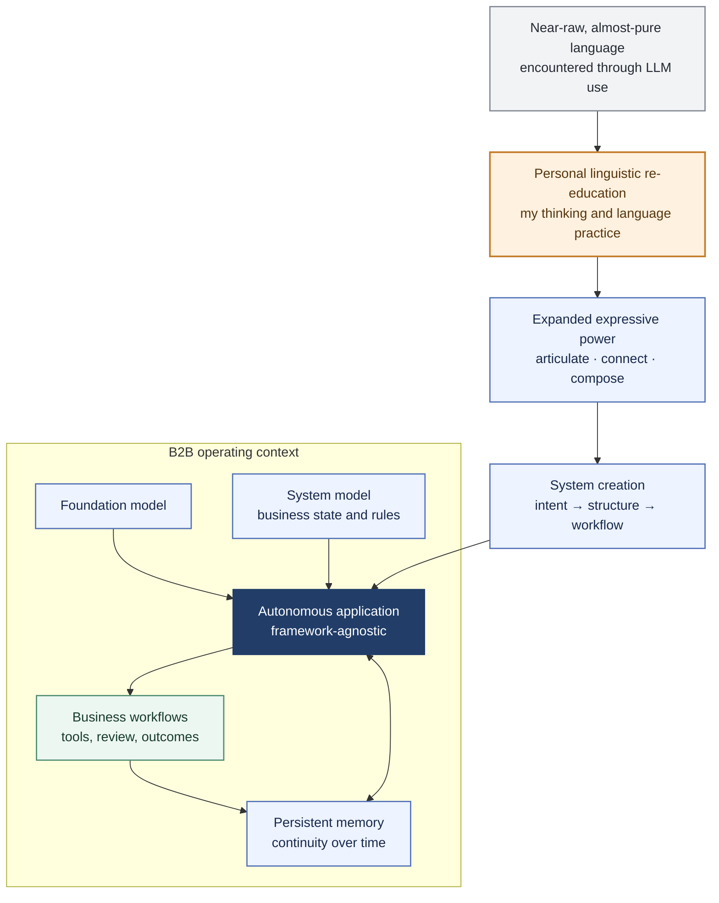

# Ícaro Glauco

## Reconstructive linguistic re-education

### Starting point

Sustained engagement with near-raw, almost-pure language through LLM use reshaped how I think and express ideas. I use **reconstructive linguistic re-education** to name this personal change in my language practice. It describes my experience; it does not claim that an LLM itself was retrained.

### Thesis: language as a medium for system creation

My thesis is that language's expressive power can shorten the path from intent to working systems. When intent is articulated, concepts connected, and relationships made explicit, language can help shape system structures and workflows. I explore this in framework-agnostic B2B applications that bring foundation models, business-system models, and persistent memory together.

### Scope and development

The personal experience motivates this design thesis; by itself, it does not establish a general causal effect, patent novelty, or technical priority. The public projects below provide concrete application contexts in procurement, domain knowledge, and learning. They show where I develop this direction, not proof of a universal result.

## Current project work

| Project | What is taking shape |
| --- | --- |
| [Prumo Licitações](https://github.com/glaucodeveloper/prumo-licitacoes) | A procurement workspace that finds public notices, connects them to company profiles, and supports document review across official sources. |
| [JUCEB Conhecimentos](https://github.com/glaucodeveloper/juceb-conhecimentos) | Curated company, tax, and fiscal knowledge for Bahia, prepared for memory-based research workflows. |
| [Lumira](https://github.com/glaucodeveloper/lumira-frontend-cognoscere) | An interactive education and competency-learning prototype, presented through a navigable product lab. |

## Patent area

Autonomous AI applications for B2B operations with persistent memory.

Together, these projects ground my inquiry in applied work: how expressive language can accelerate system creation while connecting model behavior, business state, and memory.

## Links

[Website](https://icaroglauco.online) · [GitHub repositories](https://github.com/glaucodeveloper?tab=repositories) · [Email](mailto:icaroglaucooliveira@gmail.com)
