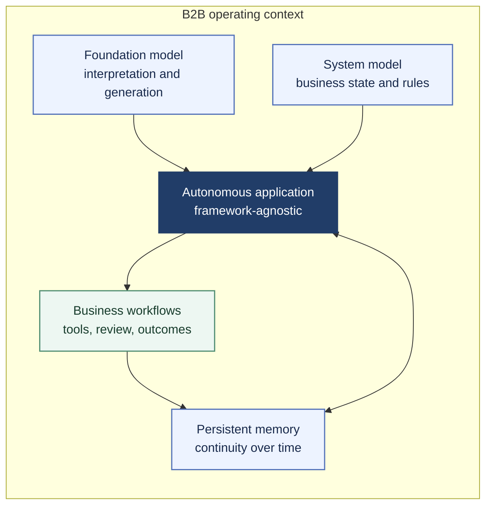

# Ícaro Glauco

### Autonomous AI for practical B2B work

My current work explores how foundation models, explicit business-system models, and persistent memory can operate together inside autonomous B2B applications. The architecture is **framework-agnostic**; the focus is the coordination of these concepts in real business workflows.

## Current project work

| Project | What is taking shape |
| --- | --- |
| [Prumo Licitações](https://github.com/glaucodeveloper/prumo-licitacoes) | A procurement workspace that finds public notices, connects them to company profiles, and supports document review across official sources. |
| [JUCEB Conhecimentos](https://github.com/glaucodeveloper/juceb-conhecimentos) | Curated company, tax, and fiscal knowledge for Bahia, prepared for memory-based research workflows. |
| [Lumira](https://github.com/glaucodeveloper/lumira-frontend-cognoscere) | An interactive education and competency-learning prototype, presented through a navigable product lab. |

## Patent area

Autonomous AI applications for B2B operations with persistent memory.

## Links

[Website](https://icaroglauco.online) · [GitHub repositories](https://github.com/glaucodeveloper?tab=repositories) · [Email](mailto:icaroglaucooliveira@gmail.com)
